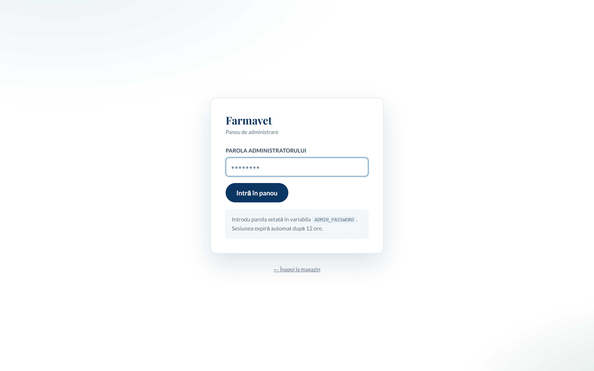
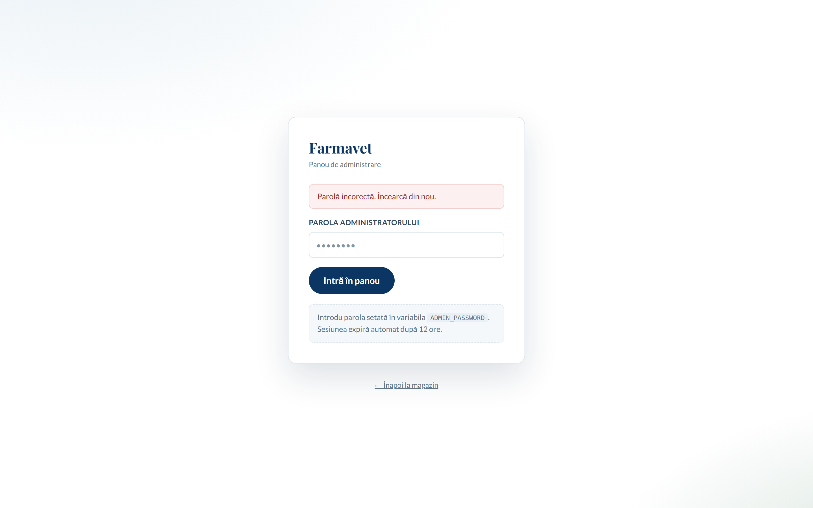
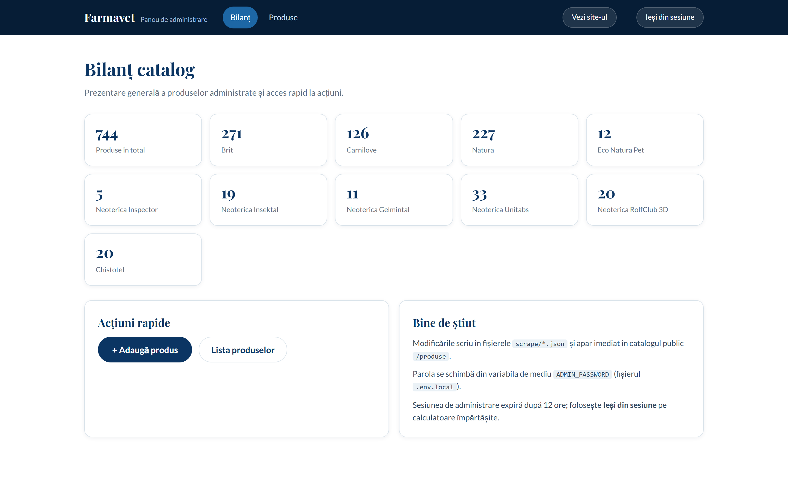
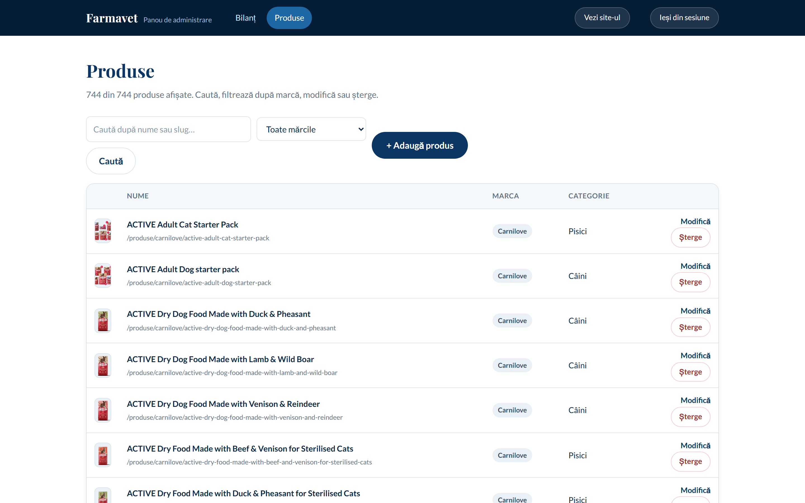
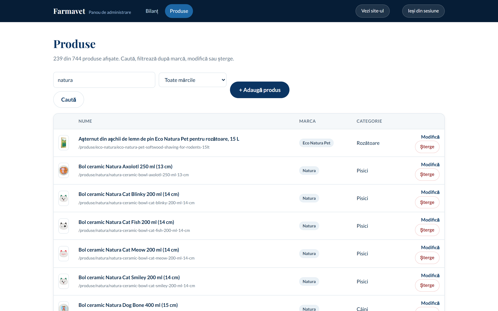
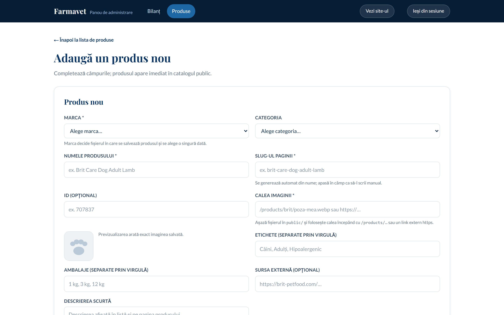
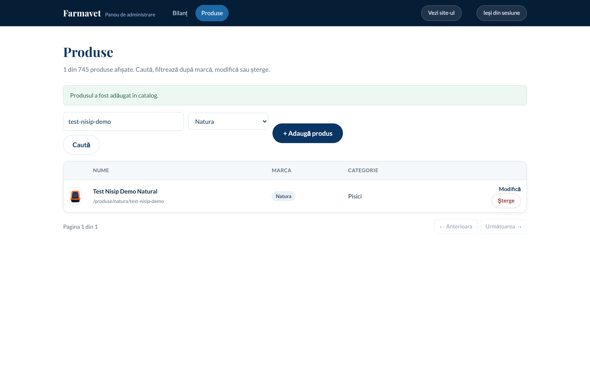
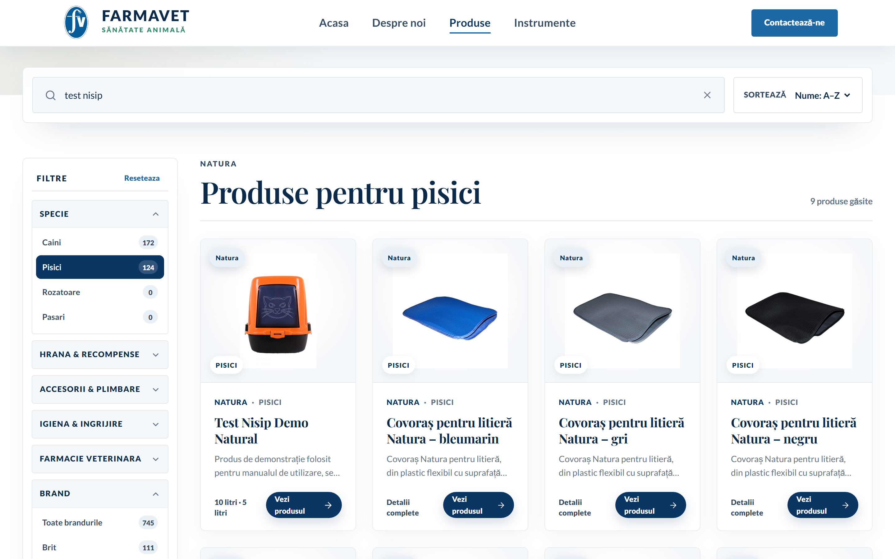
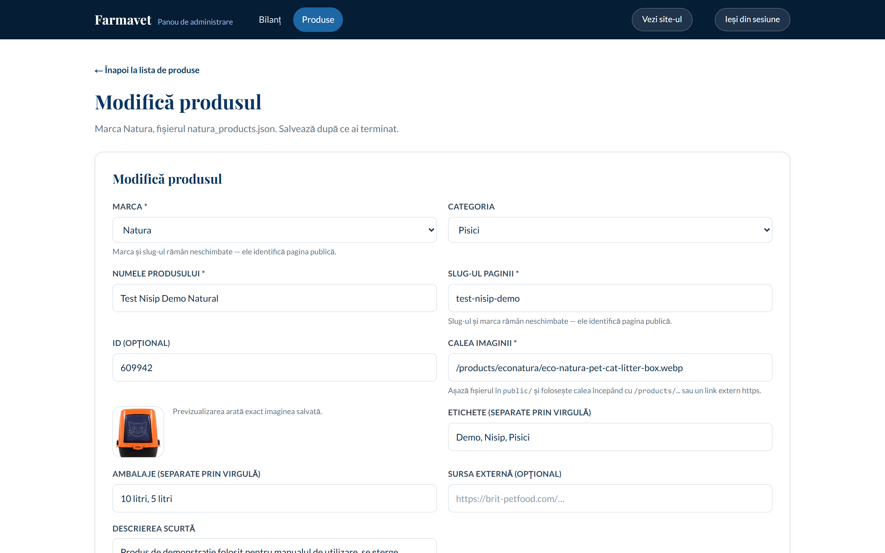
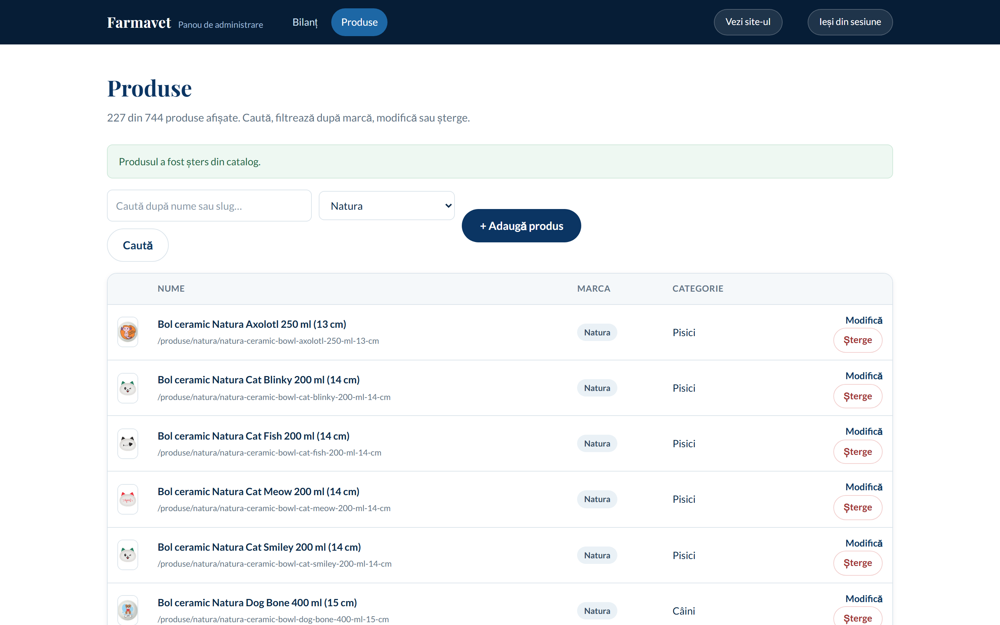

# Manual de utilizare — Panoul de administrare Farmavet

*Versiunea 1.0 · octombrie 2026*

Acest manual descrie funcționarea panoului de administrare al magazinului
**Farmavet** (site de produse veterinare și pet shop). Panoul permite
gestionarea catalogului de produse **din browser**, fără a edita manual
fișierele JSON:

- **Bilanț** — statistici despre produse;
- **Produse** — căutare, filtrare, **adăugare**, **modificare** și
  **ștergere**;
- **Ieșire din sesiune** și protecție cu parolă.

Toate capturile din manual au fost realizate automat pe interfața reală
cu scriptul `scripts/manual-screenshots.mjs`.

---

## Cuprins

1. [Accesarea panoului](#1-accesarea-panoului)
2. [Autentificarea](#2-autentificarea)
3. [Bilanț catalog](#3-bilanț-catalog)
4. [Lista de produse](#4-lista-de-produse)
5. [Adăugarea unui produs nou](#5-adăugarea-unui-produs-nou)
6. [Modificarea unui produs](#6-modificarea-unui-produs)
7. [Ștergerea unui produs](#7-ștergerea-unui-produs)
8. [Ieșirea din sesiune](#8-ieșirea-din-sesiune)
9. [Schimbarea parolei](#9-schimbarea-parolei)
10. [Unde se salvează datele](#10-unde-se-salvează-datele)
11. [Depanare — probleme frecvente](#11-depanare--probleme-frecvente)
12. [Note pentru dezvoltator](#12-note-pentru-dezvoltator)

---

## 1. Accesarea panoului

Panoul se găsește la adresa **`/admin`** (în timpul dezvoltării
`http://localhost:3000/admin`). Panoul nu apare în meniul public al
site-ului — accesul se face direct, prin adresă.

**Cerințe înainte de utilizare:**

1. Serverul aplicației pornit:

```bash
npm run dev
```

2. Fișierul `.env.local` din rădăcina proiectului configurat:

```
ADMIN_PASSWORD=farmavet2026
ADMIN_SECRET=un-șir-lung-aleatoriu
```

Dacă variabila `ADMIN_PASSWORD` lipsește, panoul afișează în locul
formularului un mesaj de configurare (vezi [Depanare](#11-depanare--probleme-frecvente)).



---

## 2. Autentificarea

Introdu parola setată în `ADMIN_PASSWORD` și apasă **„Intră în panou"**.

- Sesiunea validă durează **12 ore**, apoi expiră automat;
- Cookie-ul de sesiune este `httpOnly` și semnat HMAC-SHA256 — nu poate
  fi citit de scripturile paginii și nu poate fi falsificat;
- Cererile acțiunilor de server sunt verificate anti-CSRF de Next.js
  (comparație Origin / Host).



Dacă greșești parola, apare mesajul *„Parolă incorectă. Încearcă din
nou."* Contul nu se blochează — poți reîncerca de câte ori e nevoie.

---

## 3. Bilanț catalog

După autentificare ajungi pe ecranul **Bilanț**, cu statisticile
catalogului: numărul total de produse și câte un card pentru fiecare
marcă (Brit, Carnilove, Natura, Eco Natura Pet, produsele Neoterica și
Chistotel).



Blocul **Acțiuni rapide** conține:

| Buton | Unde duce |
|---|---|
| **+ Adaugă produs** | formularul de creare (secțiunea 5) |
| **Lista produselor** | ecranul de gestionare (secțiunea 4) |

---

## 4. Lista de produse

Ecranul **Produse** arată catalogul complet, câte 20 de produse pe pagină.



Elemente pe ecran:

- **Căutare** — potrivește numele sau slug-ul produsului;
- **Filtrul „Toate mărcile"** — restrânge lista la o singură marcă;
- **Tabelul** — imagine, nume + adresa publică, marcă, categorie și
  acțiuni;
- **Modifică** — deschide formularul de editare pentru rândul respectiv;
- **Șterge** — elimină produsul după un dialog de confirmare (secțiunea 7);
- **Paginare** — butoanele „← Anterioara" / „Următoarea →".



---

## 5. Adăugarea unui produs nou

Apasă **„+ Adaugă produs"**. Formularul se deschide gol:



### Pași

1. **Marca\*** — alege din listă. Marca decide **fișierul** în care se
   salvează produsul și nu mai poate fi schimbată după salvare.
2. **Categoria\*** — categoria animalului (Câini, Pisici, Rozătoare,
   Păsări) sau categoria veterinară potrivită.
3. **Numele produsului\*** — în timp ce scrii, câmpul **Slug** se
   generează automat din nume. Poți edita slug-ul manual după aceea.
4. **Slug-ul paginii\*** — adresa publică (`/produse/natura/<slug>`),
   unică pe marcă.
5. **ID (opțional)** — lasă-l gol; sistemul atribuie singur un ID.
6. **Calea imaginii\*** — două variante:
   - copiază fișierul în `public/products/<marcă>/` și folosește calea,
     de ex. `/products/natura/poza-mea.webp`;
   - sau un link extern `https://…`.
   
   Previzualizarea din stânga arată imaginea exactă care va fi salvată.


7. **Etichete și Ambalaje** — liste separate prin virgulă, de ex.
   `Pisici, Așternut` respectiv `10 litri, 5 litri`;
8. Apasă **„Adaugă în catalog"**. Primești un mesaj verde de confirmare
   și ești întors în listă:



### Unde apare produsul

Produsul nou este publicat imediat: pagina publică **`/produse`** citește
catalogul la fiecare deschidere. Produsul de demonstrație din manual
apare în catalog (căutarea `test nisip` în filtrul „Natura") exact ca un
produs administrat obișnuit:



---

## 6. Modificarea unui produs

De pe lista de produse, apasă **„Modifică"** pe rândul ales:



- Marca și slug-ul sunt **blocate** — ele identifică pagina publică; dacă
  vrei un alt slug, șterge produsul și creează unul nou;
- Tot restul (nume, categorie, imagine, etichete, ambalaje, descriere)
  poate fi schimbat;
- Apasă **„Salvează modificările"** — confirmarea verde apare tot în
  listă:


---

## 7. Ștergerea unui produs

Apasă **„Șterge"** pe rândul produsului. Confirmă în dialog:

> „Ești sigur? Produsul se șterge definitiv din catalog."

- **OK** → produsul dispare din fișierul JSON al mărcii și de pe site,
  imediat; în listă apare confirmarea „Produsul a fost șters":



- **Anulează** → nimic nu se întâmplă.

> **Atenție:** ștergerea este permanentă. Ultima copie recuperabilă este
> istoricul git (`git checkout -- scrape/<fișier>.json`) și funcționează
> doar atâta timp cât modificările încă nu au fost incluse într-un commit
> publicat.

---

## 8. Ieșirea din sesiune

Butonul **„Ieși din sesiune"** din bara de sus șterge cookie-ul de
administrare și te întoarce la ecranul de login. Folosește-l mereu pe
calculatoare partajate.

---

## 9. Schimbarea parolei

1. Deschide `.env.local` din rădăcina proiectului;
2. Actualizează linia `ADMIN_PASSWORD=…`;
3. Repornește serverul (`Ctrl+C`, apoi `npm run dev`).

Sesiunile vechi devin automat invalide, pentru că token-ul de sesiune e
derivat din parolă + `ADMIN_SECRET`. Pe găzduire, variabilele se
configurează în panoul platformei (ex. Vercel → Settings → Environment
Variables).

---

## 10. Unde se salvează datele

Panoul **scrie în fișierele JSON din folderul `scrape/`** — exact
sursele citite de site:

| Marcă | Fișier |
|---|---|
| Brit | `scrape/products.json` |
| Carnilove | `scrape/carnilove_products.json` |
| Natura | `scrape/natura_products.json` |
| Eco Natura Pet | `scrape/econatura_products.json` |
| Neoterica Inspector / Insektal / Gelmintal / Unitabs / RolfClub 3D și Chistotel | `scrape/ekoprom_products.json` |

**Consecințe practice:**

- modificările persistă pe disc și pot fi salvate în git (`git push`);
- pe o găzduire **fără disc scriibil** (Vercel, Netlify), modificările din
  panou nu supraviețuiesc redeploy-ului — folosește panoul pe server
  propriu (VPS) sau mută datele într-o bază de date (plan viitor);
- pagina publică de detaliu a unui produs nou se generează la prima
  accesare — nu trebuie să reconstruiești site-ul.

---

## 11. Depanare — probleme frecvente

| Simptom | Cauză + soluție |
|---|---|
| „Panoul nu este configurat" în loc de formular | Lipsește `ADMIN_PASSWORD` în `.env.local` sau serverul nu a fost repornit după modificare. |
| „Parolă incorectă" deși parola pare bună | Verifică spațiile de la marginile variabilei și că editezi fișierul corect `.env.local`. |
| Imaginea nu se încarcă | Fișierul nu există sub `public/`, sau calea nu începe cu `/products/…`. Previzualizarea din formular te avertizează. |
| „Există deja un produs cu acest slug" | Slug-ul trebuie să fie unic pe marcă; adaugă un sufix (de ex. `-2`). |
| Modificarea nu apare pe site | Reîmprospătează cu `Ctrl+Shift+R` (cache-ul browserului). |
| 404 pe pagina produsului | Verifică slug-ul exact din listă; slug-urile nu conțin diacritice sau spații. |

---

## 12. Note pentru dezvoltator

Fișierele nou adăugate pentru panou:

```
src/app/admin/                     — login (page.tsx) + actions.ts (server actions)
src/app/admin/panou/               — shell autentificat (layout.tsx), bilanț, produse
src/app/admin/ProductForm.tsx      — formularul partajat create/edit
src/lib/adminAuth.ts               — parolă + sesiune HMAC, cookie 12h
src/lib/adminCatalog.ts            — citire/scriere cataloage scrape/*.json
src/lib/slugify.ts                 — generarea slug-urilor (client + server)
scripts/manual-screenshots.mjs     — screenshoturi automatizate pentru manual
docs/manual/                       — acest manual + imaginile din img/
```

Decizii de securitate luate în calcul:

- toate acțiunile de server verifică `isAuthenticated()` **înainte** de a
  citi sau scrie fișiere — faptul că formularele se afișează doar când
  există un cookie valid nu este o măsură de securitate suficientă;
- comparația parolelor și a token-urilor folosește `timingSafeEqual`;
- panoul are `robots: noindex` și nu apare în sitemap;
- parola demo folosită pentru manual: `farmavet2026` — **schimb-o** în
  `ADMIN_PASSWORD` înainte de orice găzduire publică.

*SFÂRȘITUL MANUALULUI*
